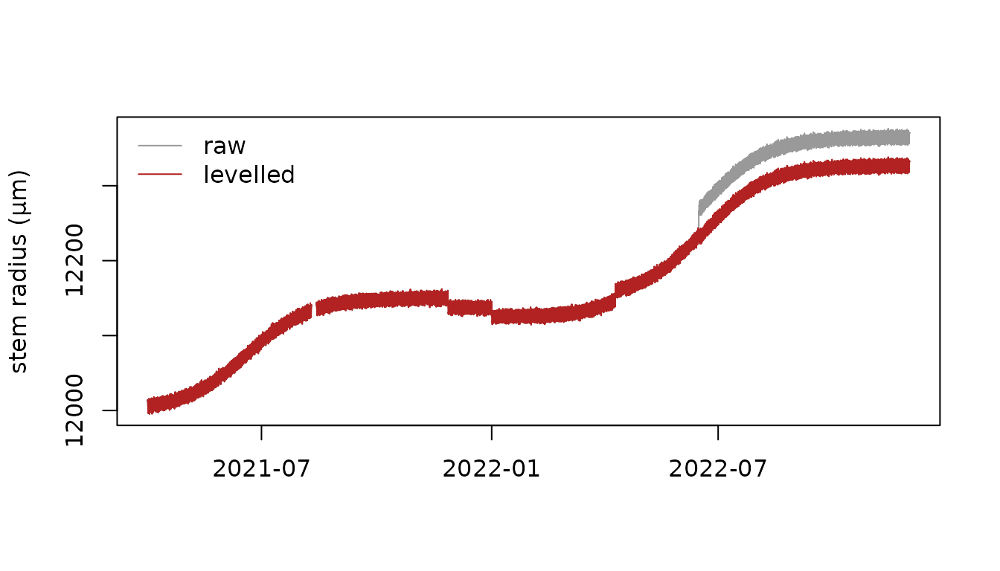

# How break leveling works

``` r

library(dendromatic)
```

A *break* is a discontinuity a sensor records that the tree did not
produce: a reinstallation, a mounting slip, a replaced logger. Deleting
the affected window is easy; the hard part is reconnecting the two sides
at the right level, because the tree kept growing while the record is
untrustworthy.

## The algorithm

For each user-confirmed break window `[b_start, b_end]`,
[`dm_level_breaks()`](https://lealzito.github.io/dendromatic/reference/dm_level_breaks.md)
does four things:

1.  **Reference lookup.** Take the nearest non-NA value before `b_start`
    (`v1`) and after `b_end` (`v2`), each bounded to within
    `growth_window_days` of the endpoint. Bounding matters: break
    endpoints usually sit at gap edges, and an unbounded search could
    grab a reference across an unrelated sensor gap and apply a wrong
    offset. If no in-window reference exists on either side, the in-gap
    span is deleted, the shift is skipped, and a warning names the
    series and break.
2.  **Delete the in-gap span** (`value <- NA` inside the window).
3.  **Growth extrapolation.** Estimate the pre-break growth rate
    (µm/day) from the `growth_window_days` before the break
    (`growth_method`: daily median regression by default), cap it at
    `max_slope_day`, and multiply by the growing-season seconds inside
    the gap – dormant time contributes no growth. Cap the total at
    `max_growth_total`.
4.  **Shift.** Add `adj = v1 - v2 + g_est` to everything after `b_end`.
    If `adj` is non-finite (an endpoint on an NA cell), the shift is
    skipped and the post-break data is preserved un-levelled, with a
    warning – never silently nulled.

Multiple breaks per series are applied in chronological order, so shifts
accumulate.

## Demonstration

``` r

d <- subset(dendro_sample, series == "SYN_Pa002")

levelled <- dm_level_breaks(
  d, brks = list(SYN_Pa002 = list(
    c("2022-06-15 10:00:00", "2022-06-15 14:00:00"))))
#> dm_level_breaks [breaks]: 1 break(s) across 1 series...
#>   |                                                          |                                                  |   0%  |                                                          |==================================================| 100%
#> 

plot(d$ts, d$value, type = "l", col = "grey60",
     xlab = "", ylab = "stem radius (µm)")
lines(levelled$ts, levelled$value, col = "firebrick")
legend("topleft", c("raw", "levelled"), col = c("grey60", "firebrick"),
       lty = 1, bty = "n")
```



The post-break segment drops by ~35 µm (the injected step) minus the
small growth extrapolated for the 4-hour window.

## The composable pipeline

[`dm_clean_series()`](https://lealzito.github.io/dendromatic/reference/dm_clean_series.md)
runs the full sequence; each step is also callable alone:

``` r

d |>
  dm_level_breaks(brks)  |>   # 1. remove sensor artefacts
  dm_erase_dormancy()    |>   # 2. NA outside the growing season
  dm_align_seasons()     |>   # 3. carry growth across winters
  dm_rebase_zero()            # 4. floor each series at zero
```

Note:
[`dm_clean_series()`](https://lealzito.github.io/dendromatic/reference/dm_clean_series.md)
runs erasure and alignment in a single combined pass (one grouped sweep
per series) and is the behavior-stable reference – its output is pinned
byte-for-byte against the original DendroMatic implementation by the
package test suite.

## Choosing the window

`growth_window_days` (default 14) controls both the reference search and
the slope window. Short windows track fast growth phases better but risk
finding no reference beside a long gap; long windows smooth the estimate
but can bridge into differently-levelled data. If a break sits beside a
long gap and you see the “no in-window reference” warning, widen the
window or move the break endpoints onto measured data.
